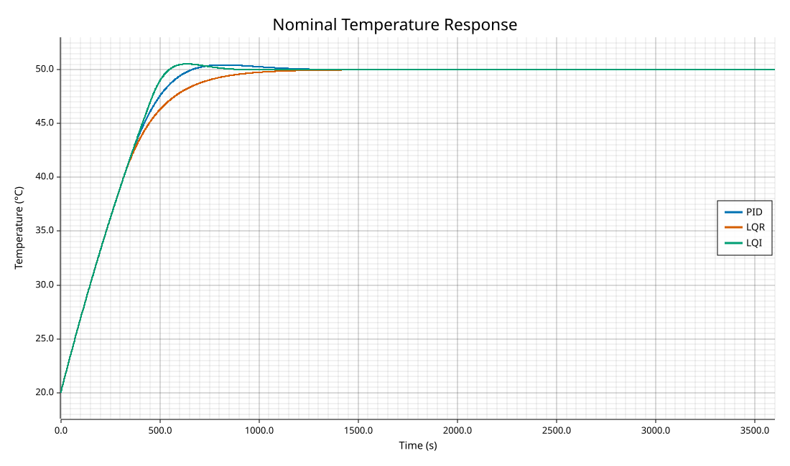
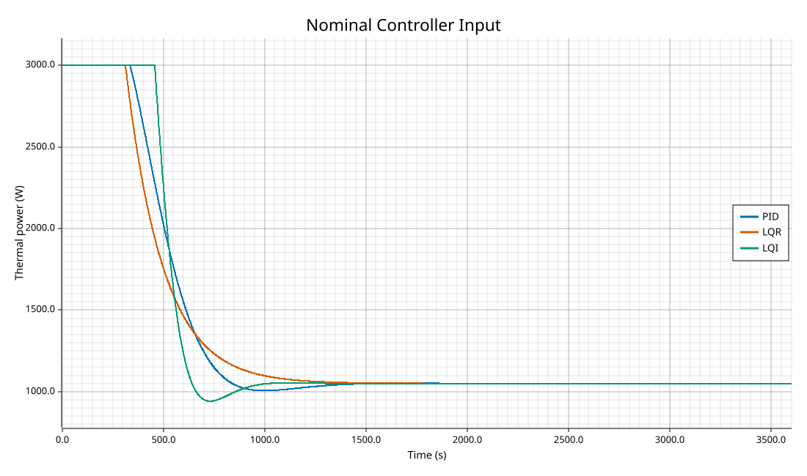
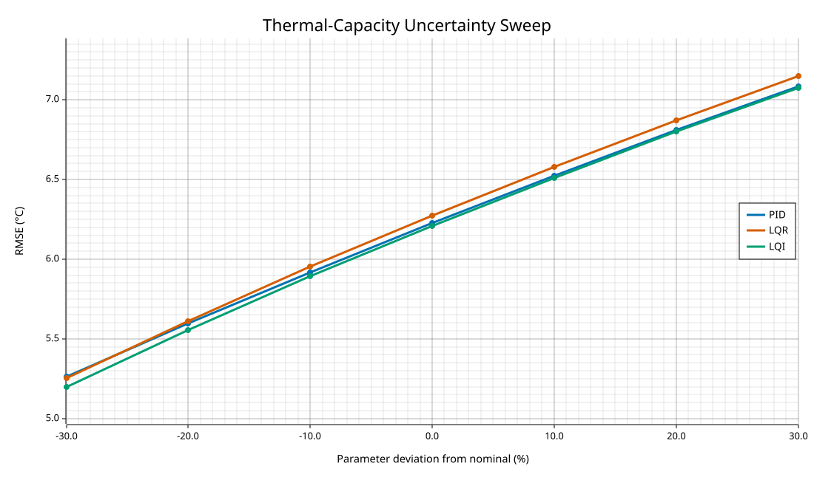
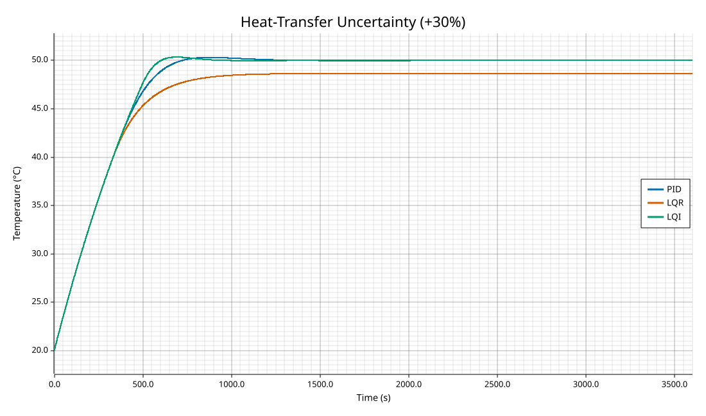
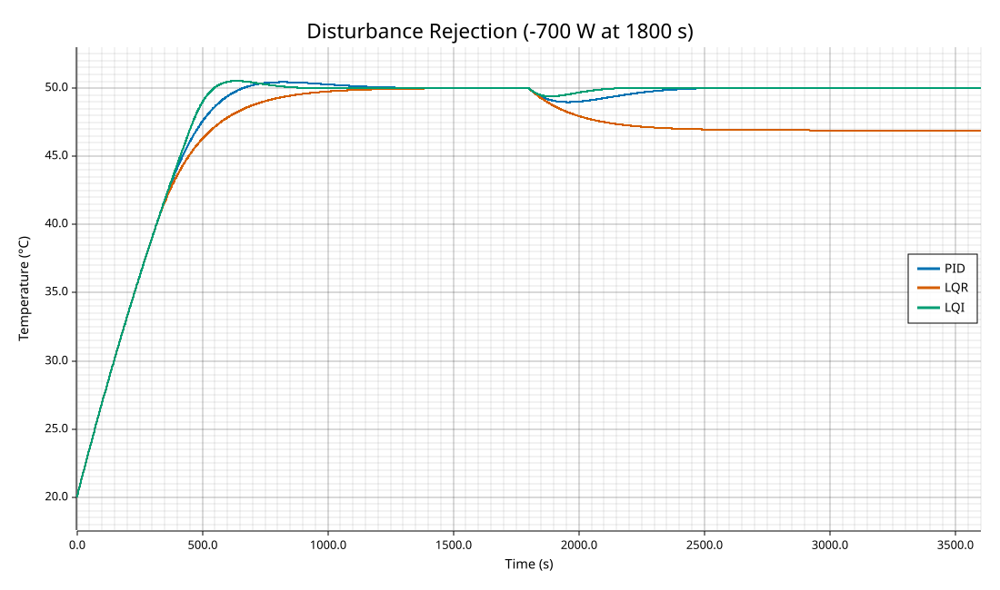
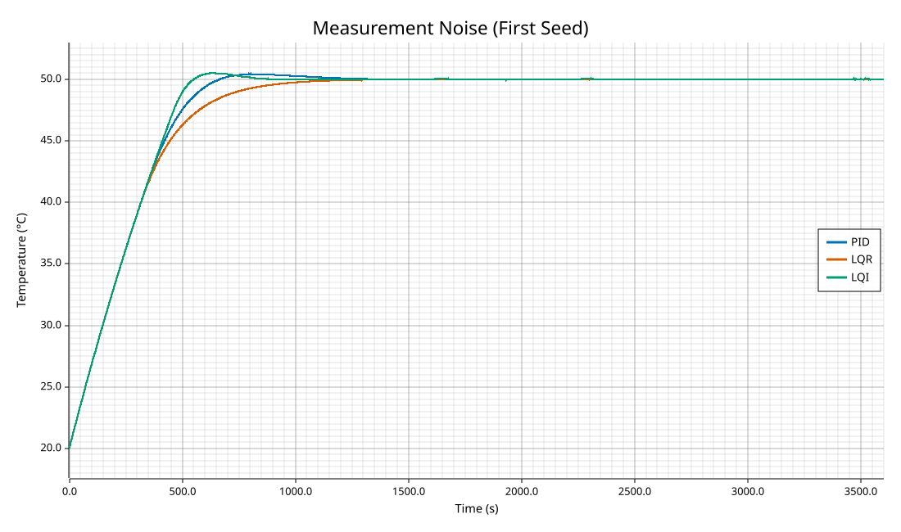
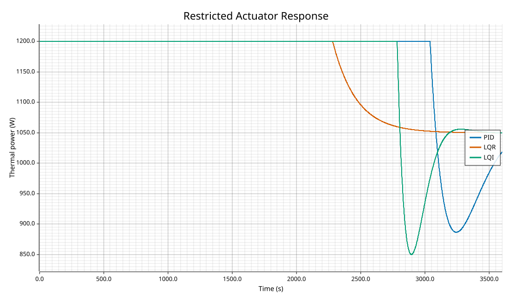
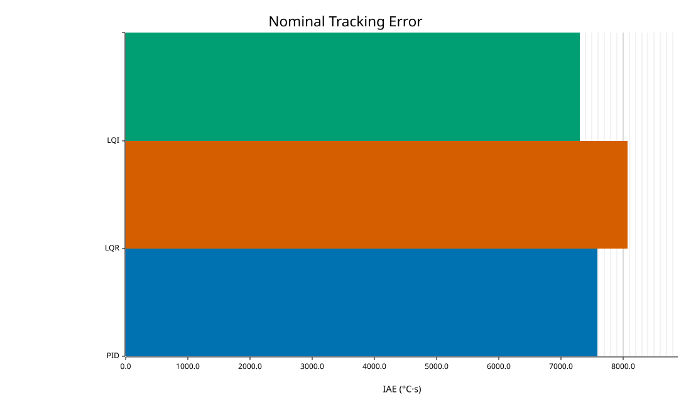
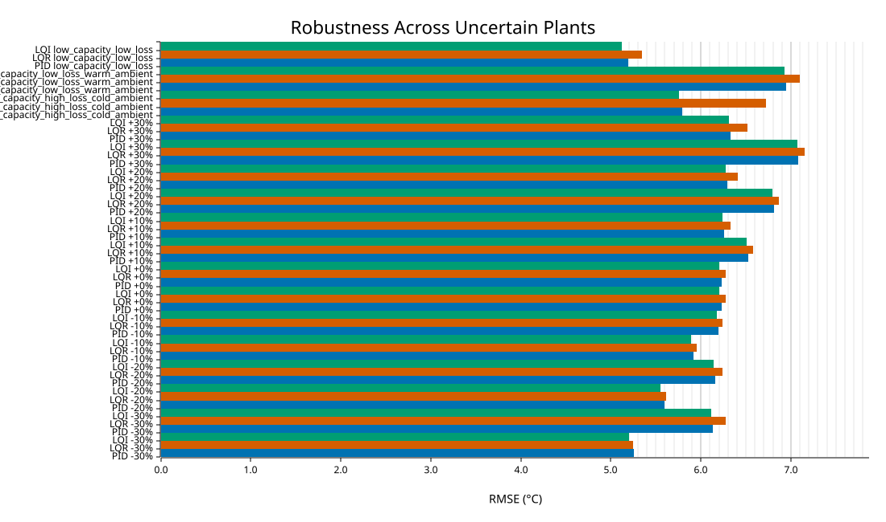

# Robustness Analysis of PID, LQR, and LQI Controllers Under Model Uncertainty in a Chemical Thermal System

## Abstract

This reproducible Rust simulation compares PID, discrete LQR, and discrete LQI temperature control for a non-reactive, well-mixed liquid vessel. Frozen nominal controllers were tested under ±30% isolated parameter changes, thermal-load disturbance, measurement noise, actuator restriction, and three combined uncertainties. Under nominal assumptions, LQI produced the lowest IAE (7303 °C·s) and RMSE (6.208 °C), followed closely by PID; LQR was slower and retained offsets under unmodeled heat loads. No controller dominated every metric: restricted-actuator IAE favored LQR, while integral controllers best removed persistent disturbance error. These are simulated findings, not experimental validation.

## Introduction and research question

Feedback design depends on a model, yet real heat capacity, heat loss, and surroundings differ from design assumptions. We ask: **How does increasing model uncertainty influence the relative performance of PID, LQR, and LQI controllers in a temperature-controlled chemical mixing process?** Secondary questions concern tracking, disturbance recovery, noise, saturation, integral action, and tuning sensitivity.

## Theoretical background and chemical context

PID combines present, accumulated, and rate-of-change error. LQR minimizes a quadratic state/input cost for a model; a regulator alone targets zero, so this implementation adds equilibrium feedforward. LQI adds integrated tracking error to the state, enabling rejection of constant mismatch when limits permit.

The liquid needs `m cp` joules per kelvin. Heat input raises temperature, while loss `UA(T-Ta)` moves it toward ambient. Perfect mixing gives one temperature. There are no reactions, concentrations, or kinetics.

## Mathematical modeling

The assumed balance is

`m cp dT/dt = Q - UA(T-Ta) + d(t)`.

With `x=T-Ta`, `x_dot=Ax+Bu+Ed`, `y=Cy x`, where `A=-UA/(m cp)`, `B=E=1/(m cp)`, and `Cy=1`. Baseline values are 10 kg, 4180 J kg⁻¹ K⁻¹, 35 W K⁻¹, and 20 °C. They are illustrative assumptions. Exact 1 s ZOH uses `Ad=exp(Ah)` and `Bd=(Ad-1)B/A`; tests compare it with the analytical exponential solution.

## Controller design

PID uses `Kp=420`, `Ki=2`, `Kd=1200`, a 15 s derivative filter, -2000/+3000 W saturation, and back-calculation. LQR uses `Q=1`, `R=2×10⁻⁵`, measured temperature feedback, and nominal heat-loss feedforward. LQI uses augmented state `z[k+1]=z[k]+h(r-y)`, weights `diag(1,8×10⁻⁴)`, and the same `R`. Both Riccati solutions are iterated to convergence and residual checked below `10⁻⁸`; augmented controllability and nominal closed-loop stability are tested. Gains never change between plants.

## Experimental methodology

Every controller receives the same measurement and runs for 3600 s from 20 °C toward 50 °C. Experiments change capacity and `UA` independently by the seven requested percentages; apply a -700 W load at 1800 s; add 0.15 °C Gaussian measurement noise across 12 shared seeds; restrict the bidirectional heater/chiller to -500/+1200 W; and combine selected parameter/ambient changes. Ambient variation remains a forcing change, not mislabeled parameter uncertainty. Metric definitions and tuning ranges appear in [methodology.md](methodology.md).

## Results

| Controller | Nominal IAE (°C·s) | RMSE (°C) | Settling (s) | Noise RMSE mean ± SD (°C) |
|---|---:|---:|---:|---:|
| PID | 7584.23 | 6.227 | 600 | 6.22677 ± 0.00035 |
| LQR | 8068.31 | 6.271 | 837 | 6.27147 ± 0.00026 |
| LQI | 7303.42 | 6.208 | 517 | 6.20756 ± 0.00004 |

Across capacity deviations, RMSE ranges were PID 5.260–7.084 °C, LQR 5.250–7.148 °C, and LQI 5.197–7.075 °C. Heat-transfer variation produced smaller ranges: PID 6.133–6.329 °C, LQR 6.242–6.518 °C, and LQI 6.111–6.314 °C.

After the -700 W load, tail-average errors were essentially zero for PID (0.00031 °C) and LQI (<10⁻⁶ °C), but 3.099 °C for LQR. LQI had the lowest disturbance IAE (7421.82 °C·s), PID was 7948.80, and LQR was 13077.24.

Under restricted limits, IAE was 26103.01 for PID, 25268.46 for LQR, and 25495.62 for LQI; LQR therefore won this specific metric, although all controllers spent substantial time saturated. Combined-case RMSE ranged 5.189–6.948 for PID, 5.345–7.101 for LQR, and 5.118–6.932 for LQI.

## Discussion

Integral action is the clearest differentiator. Nominal feedforward lets LQR track its design equilibrium, but an unknown constant load changes required equilibrium power and leaves offset. PID and LQI integrate that error away. LQI led nominal and most uncertainty RMSE comparisons, yet margins over PID were modest. When tight saturation dominated the transient, LQR's non-integrating response achieved the lowest IAE, showing that “best” depends on constraints and objective. Capacity uncertainty mainly changed speed; heat-loss and ambient mismatch also changed equilibrium demand. Noise results are descriptive paired simulations, not significance claims.

## Limitations

The model omits gradients, delay, varying properties, actuator dynamics, and reaction heat. Parameter values are assumed, noise is idealized, scenarios are sparse, and tuning is not globally optimal. Finite traces demonstrate behavior over one hour but are not mathematical proof of robust stability. See [limitations.md](limitations.md).

## Conclusion

For this model and frozen tuning, LQI offered the strongest overall tracking and constant-disturbance rejection, PID was competitive and sometimes used less saturation time, and LQR performed well only when nominal equilibrium feedforward remained accurate. Integral action improved rejection but could increase saturation exposure. The defensible conclusion is conditional rather than universal: model mismatch type and actuator constraints determine the ranking.

## References

1. University of Michigan, *Introduction: PID Controller Design*, Control Tutorials for MATLAB and Simulink, https://ctms.engin.umich.edu/CTMS/index.php?example=Introduction&section=ControlPID (accessed 2026-11-16).
2. University of Michigan, *Inverted Pendulum: State-Space Methods for Controller Design*, https://ctms.engin.umich.edu/CTMS/?example=InvertedPendulum&section=ControlStateSpace (accessed 2026-11-16).
3. MathWorks, *Continuous-Discrete Conversion Methods*, https://www.mathworks.com/help/ident/ug/continuous-discrete-conversion-methods.html (accessed 2026-11-16).
4. All numerical values in this report are generated by this repository; physical parameters are declared modeling assumptions rather than sourced measurements.
