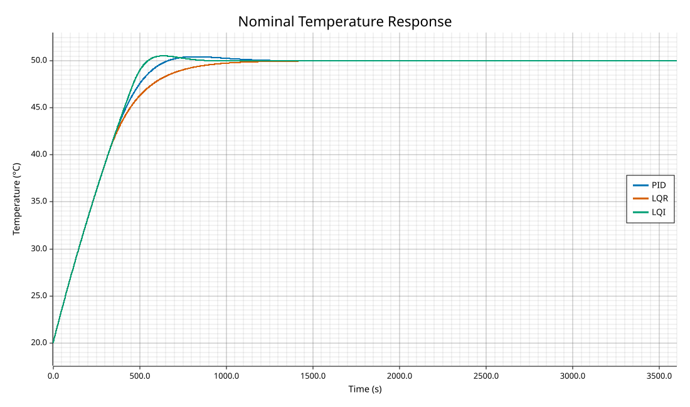
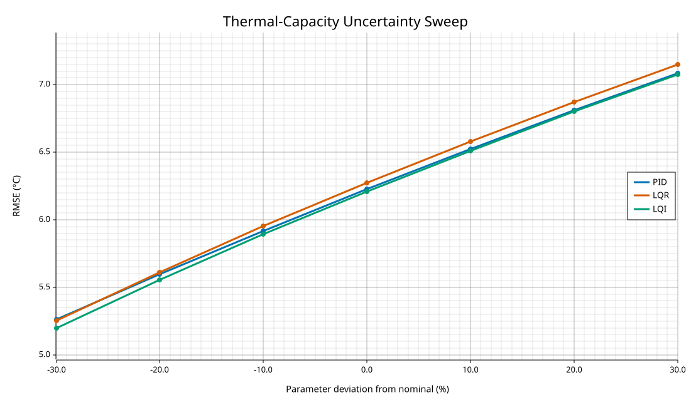
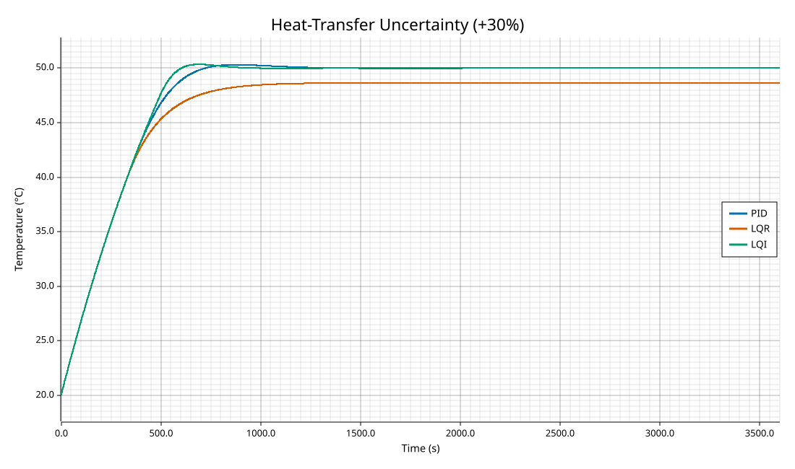
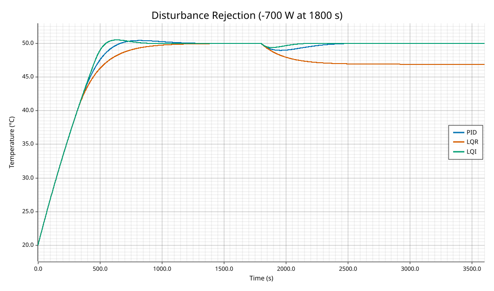
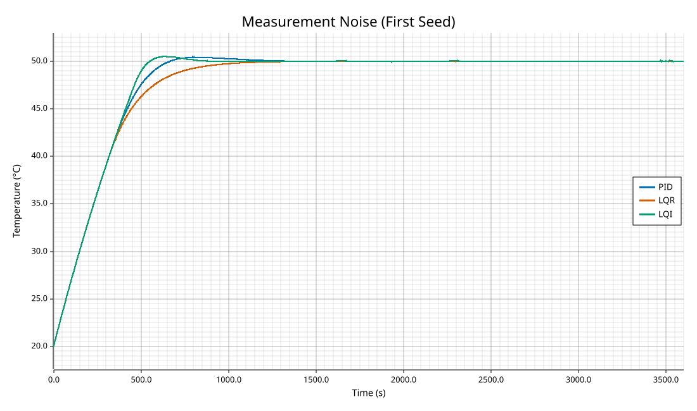
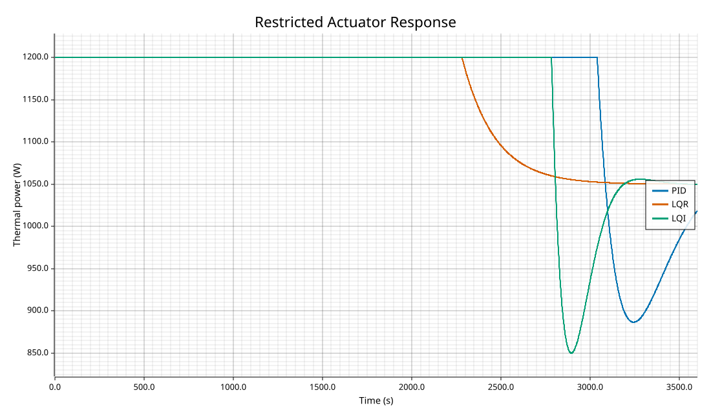

# Comparative Robustness of PID, LQR, and LQI Control Under Parametric Uncertainty in a First-Order Thermal Process

## Abstract

This computational study audits PID, discrete LQR, and LQI control for an idealized, well-mixed aqueous thermal process. An exact zero-order-hold model, independently checked Riccati solutions, frozen gains, a ±30% parameter grid, constant load, restricted bidirectional actuation, and 100 paired sensor-noise realizations are evaluated in Rust. Nominal LQI gives the lowest IAE (7304.78 °C·s) and settling time (517 s). After a -700 W load, post-step IAE is 118.88 °C·s for LQI, 365.07 for PID, and 5006.43 for non-integral LQR. Conversely, steady-regime noise RMSE for LQI exceeds PID by 0.00422 °C (95% paired CI 0.00398–0.00445). Correcting an original anti-windup-limit defect reverses the earlier saturation result. All unsaturated loops remain stable on a 61×61 parameter grid; this is gridded evidence, not a nonlinear robust-stability proof. The contribution is a comparative case study, not a novel controller or physical validation.

## 1. Introduction

Controller comparisons can mislead when tuning effort, reference handling, sensing, or actuator limits differ. This is especially true when a non-integral LQR baseline is compared with PID and LQI under a constant unknown load. This work audits such a comparison without presuming its conclusions. The chemical context is intentionally simple and the emphasis is control structure, mismatch, and constraints.

## 2. Related Work

Åström and Hägglund [1] treat PID performance, noise, robustness, and implementation. Åström and Rundqwist [2] and Rundqwist [3] explain anti-windup. Anderson and Moore [4] provide LQR/Riccati foundations; Zhou, Doyle, and Glover [5] distinguish nominal and robust properties. Teppa-Garran et al. [6] illustrate why PID/LQR comparisons need explicit tuning objectives. ZOH and discrete-LQI conventions are documented in [7,8]. This focused review is not a comprehensive novelty search.

## 3. Research Questions and Hypotheses

RQ1 asks how bounded capacity and heat-transfer mismatch affect performance. RQ2 asks when integral action helps or hurts. RQ3 asks whether saturation changes rankings.

- **H1:** With feasible actuation, PID and LQI reduce constant-load steady error relative to nominal-feedforward LQR.
- **H2:** Over the one-at-a-time ±30% grid, capacity mismatch changes RMSE more than equal percentage heat-transfer mismatch.
- **H3:** The specified restricted actuator changes the nominal IAE ranking.

These were recorded in the revised manifest before revised confirmatory execution. H1 and H2 are supported; H3 is not.

## 4. Physical System and Assumptions

The process contains 10 kg of illustrative aqueous solution with assumed constant `cp=4180 J kg⁻¹ K⁻¹`. This is water-like, not a measured formulation. The solution is homogeneous, perfectly mixed, non-reactive, and at one temperature. Assumed `UA=35 W K⁻¹`; ambient is 20 °C. A bidirectional heater/chiller supplies -2000 to +3000 W nominally. Delay, gradients, evaporation, reaction, and temperature-dependent properties are absent.

## 5. Mathematical Modeling

Conservation of energy gives

`m cp dT/dt = Q - UA(T-Ta) + d`, (1)

where disturbance `d` is thermal power in watts; negative `d` removes heat. Every term has units W. With `x=T-Ta` and `Cth=m cp`,

`x_dot=Ax+Bu+Ed`, `A=-UA/Cth`, `B=E=1/Cth`, `y=x`. (2)

For held inputs over `h`,

`Ad=exp(Ah)`, `Bd=(Ad-1)B/A`, `Ed=(Ad-1)E/A`. (3)

For constant `w=Q+d`,

`T(t)=Ta+w/UA+[T(0)-Ta-w/UA]exp[-UA t/Cth]`. (4)

Equilibrium requires `Q+d=UA(T-Ta)`. Tests compare (3) and (4) at 0.1, 1, 7.5, and 60 s samples over 100 steps to absolute tolerance `2×10⁻¹¹ °C`.

## 6. Controller Design

PID uses derivative-on-measurement, a 15 s filter, saturation, and back-calculation with `Kp=420`, `Ki=2`, `Kd=1200` in consistent SI-derived units. LQR minimizes `Σ(x'Qx+u'Ru)` with `Q=1`, `R=2×10⁻⁵` and uses nominal equilibrium feedforward plus state feedback. It is not an integral disturbance-rejection controller.

LQI augments (3):

`z[k+1]=z[k]+h(r[k]-y[k])`. (5)

Its command uses `z[k]` before storing (5), matching synthesis; weights are `diag(1,8×10⁻⁴)` and `R=2×10⁻⁵`. All controllers see measured temperature only and use the actual scenario limits.

The gains were original engineering choices, not outputs of a recorded optimizer. They are fixed baselines. ±20% gain/weight sensitivity is reported, but does not establish equal-budget optimal tuning.

## 7. Experimental Design

Runs use 1 s samples for 3600 s, from 20 to 50 °C. Training contains only nominal tracking. Validation changes gain/weight scale to 0.8 and 1.2 without selecting parameters. Frozen-gain tests cover capacity and `UA` deviations `{-30,-20,-10,0,10,20,30}%`, three combined cases with additive ambient offsets, a -700 W load at 1800 s, 0.15 °C Gaussian measurement noise, and -500/+1200 W actuation. One hundred paired seeds are independent simulation replicates; time samples are not replicates.

Metrics are IAE, ISE, RMSE, maximum error, overshoot, settling, tail error, squared effort, and saturation duration. Dedicated post-load metrics avoid confounding disturbance rejection with startup.

## 8. Numerical Validation

The scalar DARE solution is independently obtained from the positive root of

`b²P²+[R(1-a²)-Qb²]P-QR=0`. (6)

Iteration must change by less than `10⁻¹³` and leave residual below `10⁻⁸`. LQI poles are independently checked using the closed-form roots of its 2×2 matrix; augmented controllability determinant `-h b²` is nonzero. Thirteen tests cover physics, analytical trajectories, independent Riccati calculations, poles, anti-windup, quadrature, finite values, CSV consistency, and seeded reproduction.

## 9. Results

**Table 1. Nominal performance**

| Controller | IAE (°C·s) | RMSE (°C) | Settling (s) |
|---|---:|---:|---:|
| PID | 7584.23 | 6.227 | 600 |
| LQR | 8068.31 | 6.272 | 837 |
| LQI | 7304.78 | 6.208 | 517 |

Capacity uncertainty changed RMSE ranges by 1.824 °C (PID), 1.898 (LQR), and 1.878 (LQI). Heat-transfer uncertainty changed them by 0.196, 0.276, and 0.203 °C, supporting H2 only for this domain and metric.

**Table 2. Post-load recovery**

| Controller | Post-step IAE (°C·s) | Maximum error (°C) | Recovery to 0.6 °C (s) | Tail error (°C) |
|---|---:|---:|---:|---:|
| PID | 365.07 | 1.031 | 347 | 0.000313 |
| LQR | 5006.43 | 3.100 | Not reached | 3.099365 |
| LQI | 118.88 | 0.610 | 105 | <0.000001 |

This supports H1 under feasible actuation but reflects structural integral action, not general LQR inferiority. For steady-regime noise, paired LQI-minus-PID RMSE is `0.004216 °C` (95% CI `0.003978–0.004453`, `dz=3.52`). LQI-minus-LQR is `0.009969 °C`; PID-minus-LQR is `0.005754 °C`. These intervals describe Monte Carlo uncertainty under the selected noise distribution only.

Corrected restricted-actuator IAE is 25231.39 (PID), 25268.46 (LQR), and 25209.84 °C·s (LQI). Nominal and restricted rankings are both LQI, PID, LQR, so H3 is not supported. Saturation compresses differences and roughly doubles RMSE.

## 10. Robustness and Stability Analysis

Nominal stability, robust stability, nominal performance, robust performance, and finite-horizon behavior are distinct. For LQR the uncertain scalar pole is `p=Ad(Cth,UA)-Bd(Cth,UA)K`. Across the 61×61 grid, radii are 0.991930–0.996039 (LQR), 0.992397–0.995996 (PID), and 0.986843–0.993128 (LQI); no grid point is unstable. Continuity and endpoint behavior support the bounded scalar LQR interval. PID/LQI results are dense gridded evidence, not a continuous-domain proof. Saturation makes the loops nonlinear, so the pole results do not apply directly.

No instability boundary was found within ±30%. Performance degrades toward high capacity because the fixed horizon contains a slower transient. Saturation dominates when +1200 W is below the initial requested heating.

## 11. Discussion

Integral action removes feasible constant-load offset but modestly amplifies steady sensor-noise effects and interacts with saturation. Capacity mismatch affects transient RMSE more than equal percentage heat-loss mismatch in this slow plant. Correct limit plumbing reverses the original saturation conclusion. Local tuning sensitivity does not overturn the broad nominal result, but the absence of an equal-budget optimization prevents universal superiority claims.

## 12. Threats to Validity

Independent formulas, corrected quadrature, a manifest, and sensitivity runs reduce internal threats. Whole-run RMSE emphasizes the common startup transient, so dedicated recovery and steady-noise metrics were added. External validity is weak: one first-order plant, one reference, Gaussian noise, and assumed parameters do not represent industrial systems generally.

## 13. Limitations

There is no laboratory data, delay, spatial variation, reaction, nonlinear heat transfer, varying properties, or actuator dynamics. Robust stability is formal only for the scalar LQR interval argument and gridded for PID/LQI. Statistical intervals assume the chosen independent Gaussian model. Tuning fairness remains partial because gains were not produced by a recorded equal-budget optimization.

## 14. Conclusion

LQI is strongest here for nominal tracking and feasible constant-load rejection, while PID and LQR yield slightly lower steady-noise RMSE. Capacity uncertainty drives larger transient-RMSE variation than heat-transfer uncertainty. The restricted actuator does not change corrected IAE ranking, falsifying H3 for this scenario. This is a rigorous comparative computational study, not a novel method or validated chemical process.

## 15. References

[1] K. J. Åström and T. Hägglund, *Advanced PID Control*. ISA, 2006. ISBN 978-1-55617-942-6. DOI: 10.1002/9781394442102.

[2] K. J. Åström and L. Rundqwist, “Integrator Windup and How to Avoid It,” *American Control Conference*, 1989, pp. 1693–1698. DOI: 10.23919/ACC.1989.4790464.

[3] L. Rundqwist, “Anti-reset Windup for PID Controllers,” *IFAC Proceedings Volumes*, 23(8), 1990, pp. 453–458. DOI: 10.1016/S1474-6670(17)51865-0.

[4] B. D. O. Anderson and J. B. Moore, *Optimal Control: Linear Quadratic Methods*. Prentice Hall, 1990. ISBN 978-0-13-638560-8.

[5] K. Zhou, J. C. Doyle, and K. Glover, *Robust and Optimal Control*. Prentice Hall, 1996. ISBN 978-0-13-456567-5.

[6] P. Teppa-Garran, G. Bohórquez, and G. Garcia, “Optimal tuning of PID-type controllers,” *Journal of Applied Research and Technology*, 23(2), 2025, pp. 145–154. DOI: 10.22201/icat.24486736e.2025.23.2.2470.

[7] MathWorks, “Continuous-Discrete Conversion Methods,” accessed 2026-11-16, https://www.mathworks.com/help/ident/ug/continuous-discrete-conversion-methods.html.

[8] MathWorks, “Linear-Quadratic-Integral Control,” accessed 2026-11-16, https://www.mathworks.com/help/control/ref/ss.lqi.html.

## 16. Reproducibility Statement

All executable code is Rust. Toolchain, dependencies, assumptions, gains, splits, seeds, tolerances, CSV/SVG artifacts, and checksums are tracked. From a clean checkout, run `cargo test --all-targets` and `cargo run --release -- run-all`; exact commands and hashes are in `docs/reproducibility.md`.
